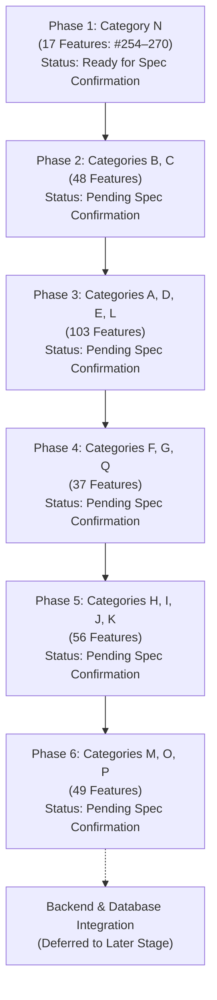

# Development Roadmap: Local Cricket Management Platform

> **Status:** Active Baseline  
> **Total Scope:** 310 Planned Features | 17 Categories (A–Q) | 6 Phases  
> **Development Priority:** Frontend Development First  
> **Backend & Database:** Deferred to Subsequent Phases  
> **Current Code State:** No application code or database created yet  

---

## 1. Roadmap Overview & Strategic Directives

The development lifecycle for the **Local Cricket Management Platform** is organized across six distinct phases. The execution philosophy strictly mandates:
1. **Frontend First:** Visual presentation, workflows, interfaces, and mock user states will be established before any database schema or backend logic is developed.
2. **No Speculative Feature Inventions:** Feature numbering (1–310) and category allocations (A–Q) are immutable. Specific feature descriptions that have not yet been provided are recorded as **Pending Source Confirmation**.
3. **Infrastructure Evaluation:** Hostinger deployment compatibility inspection and technology stack finalization precede actual code authoring.

---

## 2. Phase Breakdown

### Phase 1: Foundation & Category N
- **Target Category:** **Category N**
- **Feature Count:** **17 features**
- **Feature Numbering:** **Features #254 to #270**
- **Primary Focus:** Establishing initial platform layouts, Category N user interfaces, and mock data models.
- **Detailed Feature Descriptions:**
  - Feature #254: *[Pending Source Confirmation]*
  - Feature #255: *[Pending Source Confirmation]*
  - Feature #256: *[Pending Source Confirmation]*
  - Feature #257: *[Pending Source Confirmation]*
  - Feature #258: *[Pending Source Confirmation]*
  - Feature #259: *[Pending Source Confirmation]*
  - Feature #260: *[Pending Source Confirmation]*
  - Feature #261: *[Pending Source Confirmation]*
  - Feature #262: *[Pending Source Confirmation]*
  - Feature #263: *[Pending Source Confirmation]*
  - Feature #264: *[Pending Source Confirmation]*
  - Feature #265: *[Pending Source Confirmation]*
  - Feature #266: *[Pending Source Confirmation]*
  - Feature #267: *[Pending Source Confirmation]*
  - Feature #268: *[Pending Source Confirmation]*
  - Feature #269: *[Pending Source Confirmation]*
  - Feature #270: *[Pending Source Confirmation]*
- **Phase Prerequisites:**
  - Finalize technology stack selection.
  - Complete Hostinger deployment compatibility inspection.
  - Receive source specifications for features #254–270.
- **Current Status:** **Not Started / Specification Pending**

---

### Phase 2: Categories B & C
- **Target Categories:** **Category B**, **Category C**
- **Feature Count:** **48 features**
- **Primary Focus:** Frontend module implementation for Categories B & C.
- **Detailed Feature Descriptions:** *Pending source confirmation.* (Feature numbers reserved within project master list).
- **Prerequisites:** Successful delivery of Phase 1 frontend components.
- **Current Status:** **Not Started / Specification Pending**

---

### Phase 3: Categories A, D, E & L
- **Target Categories:** **Category A**, **Category D**, **Category E**, **Category L**
- **Feature Count:** **103 features**
- **Primary Focus:** Core operational interfaces, match management structures, player registers, and league administrative views.
- **Detailed Feature Descriptions:** *Pending source confirmation.* (Feature numbers reserved within project master list).
- **Prerequisites:** Completion of Phase 1 and Phase 2 frontend modules.
- **Current Status:** **Not Started / Specification Pending**

---

### Phase 4: Categories F, G & Q
- **Target Categories:** **Category F**, **Category G**, **Category Q**
- **Feature Count:** **37 features**
- **Primary Focus:** Specialized views, match scoring, team communication, and reporting modules.
- **Detailed Feature Descriptions:** *Pending source confirmation.* (Feature numbers reserved within project master list).
- **Prerequisites:** Completion of Phase 3 frontend modules.
- **Current Status:** **Not Started / Specification Pending**

---

### Phase 5: Categories H, I, J & K
- **Target Categories:** **Category H**, **Category I**, **Category J**, **Category K**
- **Feature Count:** **56 features**
- **Primary Focus:** Analytics, player performance indices, administrative dashboards, and tournament progression trackers.
- **Detailed Feature Descriptions:** *Pending source confirmation.* (Feature numbers reserved within project master list).
- **Prerequisites:** Completion of Phase 4 frontend modules.
- **Current Status:** **Not Started / Specification Pending**

---

### Phase 6: Categories M, O & P
- **Target Categories:** **Category M**, **Category O**, **Category P**
- **Feature Count:** **49 features**
- **Primary Focus:** Community portals, public spectator pages, notification hubs, and platform settings.
- **Detailed Feature Descriptions:** *Pending source confirmation.* (Feature numbers reserved within project master list).
- **Prerequisites:** Completion of Phase 5 frontend modules.
- **Current Status:** **Not Started / Specification Pending**

---

### Subsequent Phase: Backend, Database & Integration
- **Primary Focus:**
  - Finalize database engine and design normalized relational schemas.
  - Provision database instances and secure connection credentials.
  - Develop REST/GraphQL API services connecting the existing frontend interfaces to the database.
  - Migrate frontend mock providers to live backend endpoints.
- **Current Status:** **Deliberately Deferred**

---

## 3. Milestone Summary & Target Progress

| Milestone | Target Scope | Target Deliverable | Dependency / Prerequisite |
| :--- | :--- | :--- | :--- |
| **M0: Project Setup** | Documentation & Architecture | All 8 reference docs complete | Git repo initialized, GitHub remote linked |
| **M1: Tech Stack & Hostinger Audit** | Architecture | Stack decided & Hostinger compatibility inspected | Server environment constraints verified |
| **M2: Phase 1 (Category N)** | Features #254–270 (17) | Category N frontend views (mock data) | Source feature descriptions confirmed |
| **M3: Phase 2 (Categories B, C)** | 48 Features | Categories B & C frontend views | Source feature descriptions confirmed |
| **M4: Phase 3 (Categories A, D, E, L)** | 103 Features | Categories A, D, E & L frontend views | Source feature descriptions confirmed |
| **M5: Phase 4 (Categories F, G, Q)** | 37 Features | Categories F, G & Q frontend views | Source feature descriptions confirmed |
| **M6: Phase 5 (Categories H, I, J, K)** | 56 Features | Categories H, I, J & K frontend views | Source feature descriptions confirmed |
| **M7: Phase 6 (Categories M, O, P)** | 49 Features | Categories M, O & P frontend views | Source feature descriptions confirmed |
| **M8: Backend & Database** | Complete 310 Features | Persistent database, APIs, authentication | Full frontend validation completed |
| **M9: Production Deployment** | Production Go-Live | Main domain mapped & production deployment | Permanent domain purchased |

