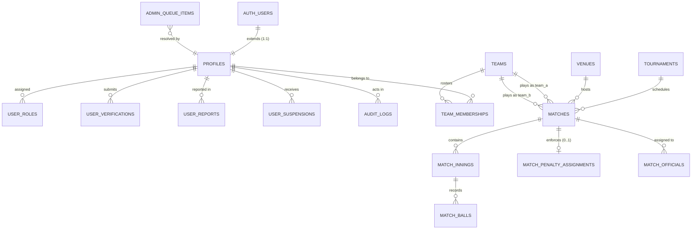

# Proposed Supabase PostgreSQL Database Schema
## Local Cricket Management Platform

> **Document Type:** Architectural Database Schema Proposal (Review Only)  
> **Target Database Engine:** PostgreSQL 15+ (Hosted on Supabase)  
> **Status:** Proposed for Architectural Review — **No SQL Executed / No DB Tables Created**  
> **Alignment:** Master Blueprint v1.1.0 (`docs/01-MASTER-BLUEPRINT.md`), Database Documentation (`docs/04-DATABASE-DOCUMENTATION.md`), Progress Tracker (`docs/03-PROGRESS-TRACKER.md`), and Phase 1 Frontend Codebase (`src/`).

---

## 1. Executive Summary & Comparative Audit

An exhaustive inspection of the project's documentation (`docs/01-MASTER-BLUEPRINT.md`, `docs/04-DATABASE-DOCUMENTATION.md`, `docs/03-PROGRESS-TRACKER.md`, `docs/05-API-DOCUMENTATION.md`, `docs/08-CURRENT-STATUS.md`) and the operational frontend codebase (`src/services/dataService.js`, `src/services/mock/mockClient.js`, `src/views/`) was conducted.

### 1.1 Requirements vs. Implementation Comparison Matrix

| Domain / Category | Master Blueprint Requirement | Frontend Implementation Status | Database Schema Mapping Status |
| :--- | :--- | :--- | :--- |
| **Category N: Phase 1 (#254–270)** | 17 specific administration, security, RBAC, and governance features | 100% Implemented in frontend via `dataService.js` and `mockClient.js` | **Fully Mapped (11 Dedicated Tables)** with exact column, constraint, and RLS definitions |
| **Category Q: Penalty Rules** | Late arrival penalty enforcement (3 methods: overs deduction, fielding penalty, penalty runs; single active method) | Confirmed policy rules displayed in `PenaltyRulesView.jsx` and `mockCategoryQPenaltyPolicy` | **Fully Mapped (`match_penalty_assignments`)** with strict check constraints enforcing single method per match |
| **Core Cricket Operations (Tournaments, Teams, Matches)** | High-level entities supporting league management and match scheduling | Implemented in `mockTournaments`, `mockTeams`, `mockMatches`, `DashboardOverview.jsx`, `MatchesView.jsx`, `TournamentsView.jsx` | **Fully Mapped (9 Core Cricket Tables)** covering venues, tournaments, teams, memberships, fixtures, innings, and ball-by-ball scoring |
| **Categories A–M, O, P (Phases 2–6: 293 Features)** | 310 total reserved feature slots across 17 categories | Feature slots explicitly reserved in tracker; implementation pending source confirmation | **Extensible Foundation Provided** without inventing or fabricating unconfirmed feature requirements |

---

## 2. Missing Information, Ambiguities & Architectural Conflicts

In strict accordance with project directives, the following gaps, ambiguities, and technical conflicts have been identified and must be reviewed prior to database provisioning:

### 2.1 Identity & Authentication Integration Conflict
- **Current Frontend:** Uses simulated client-side identifier resolution accepting either an email address or a 10-digit Indian mobile number (`normalizeMobile()` in `mockClient.js`), generating arbitrary string IDs (e.g., `'usr-1001'`).
- **Supabase Standard:** Supabase Auth manages user credentials inside the isolated `auth.users` schema using UUID primary keys (`id UUID PRIMARY KEY`).
- **Resolution in Proposed Schema:**
  - Create a public profile table `public.profiles` whose primary key `id` is a `UUID` referencing `auth.users(id) ON DELETE CASCADE`.
  - Maintain normalized `email` (RFC 5322 lowercase) and `mobile_number` (E.164 formatted string, default `+91`) with unique constraints in `public.profiles`.
  - Provide a PostgreSQL trigger function (`handle_new_user()`) that automatically synchronizes identity records upon Supabase Auth sign-up.

### 2.2 Category Q Late Arrival Penalty Cardinality
- **Blueprint Constraint:** Master Blueprint Section 5 explicitly dictates: *"Only ONE penalty method can be active in a match"* (Overs deduction, Fielding restriction, OR Penalty runs).
- **Resolution in Proposed Schema:**
  - In `public.match_penalty_assignments`, enforce a composite unique constraint `UNIQUE (match_id)` and a check constraint `CHECK (penalty_method IN ('overs_deduction', 'fielding_restriction', 'penalty_runs'))`, guaranteeing that at most one active penalty record can exist per match.

### 2.3 Feature #268: Database Backup in a Managed Cloud DB
- **Frontend Behavior:** Feature #268 renders an administrative UI displaying backup snapshot archives, SHA-256 checksums, and a button to trigger on-demand backups.
- **Supabase Reality:** Supabase executes physical WAL archiving and daily automated PostgreSQL dumps at the platform infrastructure level. Frontend clients cannot and should not trigger physical filesystem `pg_dump` commands directly over client connections.
- **Resolution in Proposed Schema:**
  - Create `public.database_backups` to log and store snapshot metadata, schema version manifests, export timestamps, and automated disaster recovery verification status. Physical snapshots are orchestrated via backend serverless functions or Supabase Management APIs.

### 2.4 Missing Specifications for Categories A–M, O, P (293 Features)
- **Status:** Detailed business rules for Categories A–M, O, and P remain pending source confirmation from the project owner.
- **Architectural Policy:** The database schema establishes clean foreign-key foundations (e.g. `tournaments`, `teams`, `matches`, `innings`, `balls`, `officials`) so that subsequent categories can attach without schema rewrites, but strictly avoids fabricating unconfirmed tables.

---

## 3. Entity Relationship Overview



---

## 4. Proposed PostgreSQL Schema Specification

### 4.1 Security & User Management Domain (Category N: Phase 1)

#### Table 1: `public.profiles`
*Extends `auth.users` with cricket platform attributes, mobile numbers, verification badges, and compliance fields.*

```sql
CREATE TABLE public.profiles (
    id UUID PRIMARY KEY REFERENCES auth.users(id) ON DELETE CASCADE,
    full_name TEXT NOT NULL CHECK (char_length(trim(full_name)) >= 2),
    email TEXT UNIQUE NOT NULL CHECK (email ~* '^[A-Za-z0-9._%+-]+@[A-Za-z0-9.-]+\.[A-Za-z]{2,}$'),
    mobile_number VARCHAR(15) UNIQUE NOT NULL CHECK (mobile_number ~ '^[0-9]{10}$'),
    role TEXT NOT NULL DEFAULT 'player' CHECK (role IN ('super_admin', 'admin', 'organiser', 'team_owner', 'captain', 'scorer', 'umpire', 'player', 'member')),
    is_verified BOOLEAN NOT NULL DEFAULT false,
    is_suspended BOOLEAN NOT NULL DEFAULT false,
    terms_accepted BOOLEAN NOT NULL DEFAULT true CHECK (terms_accepted = true),
    terms_accepted_at TIMESTAMPTZ NOT NULL DEFAULT timezone('utc'::text, now()),
    dpdp_consent_given BOOLEAN NOT NULL DEFAULT true,
    created_at TIMESTAMPTZ NOT NULL DEFAULT timezone('utc'::text, now()),
    updated_at TIMESTAMPTZ NOT NULL DEFAULT timezone('utc'::text, now())
);

CREATE INDEX idx_profiles_email ON public.profiles(email);
CREATE INDEX idx_profiles_mobile ON public.profiles(mobile_number);
CREATE INDEX idx_profiles_role ON public.profiles(role);
CREATE INDEX idx_profiles_status ON public.profiles(is_verified, is_suspended);
```

#### Table 2: `public.role_permissions`
*Implements Features #259–#264: dynamic role permission capabilities.*

```sql
CREATE TABLE public.role_permissions (
    id BIGSERIAL PRIMARY KEY,
    role TEXT NOT NULL CHECK (role IN ('super_admin', 'admin', 'organiser', 'team_owner', 'captain', 'scorer', 'umpire', 'player')),
    permission_key TEXT NOT NULL,
    permission_label TEXT NOT NULL,
    description TEXT,
    is_enabled BOOLEAN NOT NULL DEFAULT true,
    updated_by UUID REFERENCES public.profiles(id) ON DELETE SET NULL,
    updated_at TIMESTAMPTZ NOT NULL DEFAULT timezone('utc'::text, now()),
    CONSTRAINT uq_role_permission UNIQUE (role, permission_key)
);

CREATE INDEX idx_role_permissions_role ON public.role_permissions(role);
```

#### Table 3: `public.user_verifications`
*Implements Feature #265: Official document and credential audit queue.*

```sql
CREATE TABLE public.user_verifications (
    id UUID PRIMARY KEY DEFAULT gen_random_uuid(),
    user_id UUID NOT NULL REFERENCES public.profiles(id) ON DELETE CASCADE,
    role_requested TEXT NOT NULL,
    document_type TEXT NOT NULL CHECK (document_type IN ('national_id', 'aadhaar', 'umpire_certificate', 'scorer_license', 'other')),
    document_number_masked TEXT NOT NULL,
    document_url TEXT,
    club_name TEXT,
    status TEXT NOT NULL DEFAULT 'pending' CHECK (status IN ('pending', 'verified', 'rejected')),
    rejection_reason TEXT,
    submitted_at TIMESTAMPTZ NOT NULL DEFAULT timezone('utc'::text, now()),
    processed_at TIMESTAMPTZ,
    processed_by UUID REFERENCES public.profiles(id) ON DELETE SET NULL
);

CREATE INDEX idx_verifications_status ON public.user_verifications(status);
CREATE INDEX idx_verifications_user ON public.user_verifications(user_id);
```

#### Table 4: `public.user_reports`
*Implements Feature #266: Incident desk and code-of-conduct violation reports.*

```sql
CREATE TABLE public.user_reports (
    id UUID PRIMARY KEY DEFAULT gen_random_uuid(),
    reported_user_id UUID NOT NULL REFERENCES public.profiles(id) ON DELETE CASCADE,
    reported_by_id UUID NOT NULL REFERENCES public.profiles(id) ON DELETE CASCADE,
    match_ref TEXT,
    incident_type TEXT NOT NULL,
    severity TEXT NOT NULL DEFAULT 'medium' CHECK (severity IN ('low', 'medium', 'high', 'critical')),
    description TEXT NOT NULL,
    status TEXT NOT NULL DEFAULT 'under_review' CHECK (status IN ('under_review', 'investigating', 'resolved', 'dismissed')),
    created_at TIMESTAMPTZ NOT NULL DEFAULT timezone('utc'::text, now()),
    resolved_at TIMESTAMPTZ,
    resolved_by UUID REFERENCES public.profiles(id) ON DELETE SET NULL
);

CREATE INDEX idx_user_reports_reported ON public.user_reports(reported_user_id);
CREATE INDEX idx_user_reports_status ON public.user_reports(status);
```

#### Table 5: `public.user_suspensions`
*Implements Feature #266: Disciplinary temporary bans and suspensions.*

```sql
CREATE TABLE public.user_suspensions (
    id UUID PRIMARY KEY DEFAULT gen_random_uuid(),
    user_id UUID NOT NULL REFERENCES public.profiles(id) ON DELETE CASCADE,
    imposed_by_id UUID NOT NULL REFERENCES public.profiles(id) ON DELETE RESTRICT,
    reason TEXT NOT NULL,
    duration TEXT NOT NULL,
    start_date TIMESTAMPTZ NOT NULL DEFAULT timezone('utc'::text, now()),
    end_date TIMESTAMPTZ,
    status TEXT NOT NULL DEFAULT 'active' CHECK (status IN ('active', 'lifted', 'expired')),
    lifted_at TIMESTAMPTZ,
    lifted_by_id UUID REFERENCES public.profiles(id) ON DELETE SET NULL,
    notes TEXT,
    created_at TIMESTAMPTZ NOT NULL DEFAULT timezone('utc'::text, now())
);

CREATE INDEX idx_suspensions_user ON public.user_suspensions(user_id);
CREATE INDEX idx_suspensions_status ON public.user_suspensions(status);
```

#### Table 6: `public.audit_logs`
*Implements Feature #267: Immutable chronological platform activity trail.*

```sql
CREATE TABLE public.audit_logs (
    id UUID PRIMARY KEY DEFAULT gen_random_uuid(),
    actor_id UUID REFERENCES public.profiles(id) ON DELETE SET NULL,
    actor_name TEXT NOT NULL,
    role TEXT NOT NULL,
    action TEXT NOT NULL,
    target TEXT NOT NULL,
    ip_address INET,
    severity TEXT NOT NULL DEFAULT 'INFO' CHECK (severity IN ('INFO', 'WARNING', 'CRITICAL')),
    details TEXT,
    created_at TIMESTAMPTZ NOT NULL DEFAULT timezone('utc'::text, now())
);

CREATE INDEX idx_audit_logs_timestamp ON public.audit_logs(created_at DESC);
CREATE INDEX idx_audit_logs_action ON public.audit_logs(action);
CREATE INDEX idx_audit_logs_severity ON public.audit_logs(severity);
```

#### Table 7: `public.database_backups`
*Implements Feature #268: Database snapshot archives and restore verification tracking.*

```sql
CREATE TABLE public.database_backups (
    id TEXT PRIMARY KEY,
    snapshot_type TEXT NOT NULL,
    size_bytes BIGINT NOT NULL,
    size_formatted TEXT NOT NULL,
    checksum_sha256 TEXT NOT NULL,
    records_count INTEGER NOT NULL,
    status TEXT NOT NULL DEFAULT 'verified' CHECK (status IN ('verified', 'in_progress', 'failed')),
    created_at TIMESTAMPTZ NOT NULL DEFAULT timezone('utc'::text, now()),
    created_by UUID REFERENCES public.profiles(id) ON DELETE SET NULL
);

CREATE INDEX idx_backups_created ON public.database_backups(created_at DESC);
```

#### Table 8: `public.security_settings`
*Implements Feature #269: Platform-wide security policies and session parameters.*

```sql
CREATE TABLE public.security_settings (
    id SMALLINT PRIMARY KEY DEFAULT 1 CHECK (id = 1),
    two_factor_auth_required BOOLEAN NOT NULL DEFAULT false,
    session_timeout_minutes INTEGER NOT NULL DEFAULT 60 CHECK (session_timeout_minutes BETWEEN 15 AND 1440),
    max_failed_attempts INTEGER NOT NULL DEFAULT 5 CHECK (max_failed_attempts BETWEEN 3 AND 10),
    password_expiry_days INTEGER NOT NULL DEFAULT 90 CHECK (password_expiry_days BETWEEN 0 AND 365),
    allow_mobile_login BOOLEAN NOT NULL DEFAULT true,
    privacy_data_export_enabled BOOLEAN NOT NULL DEFAULT true,
    updated_at TIMESTAMPTZ NOT NULL DEFAULT timezone('utc'::text, now()),
    updated_by UUID REFERENCES public.profiles(id) ON DELETE SET NULL
);
```

#### Table 9: `public.notification_channels` & Table 10: `public.notifications`
*Implements Feature #270: Multi-channel notifications configuration and dispatch history.*

```sql
CREATE TABLE public.notification_channels (
    id SMALLINT PRIMARY KEY DEFAULT 1 CHECK (id = 1),
    sms_enabled BOOLEAN NOT NULL DEFAULT true,
    email_enabled BOOLEAN NOT NULL DEFAULT true,
    push_enabled BOOLEAN NOT NULL DEFAULT true,
    in_app_banner BOOLEAN NOT NULL DEFAULT true,
    updated_at TIMESTAMPTZ NOT NULL DEFAULT timezone('utc'::text, now()),
    updated_by UUID REFERENCES public.profiles(id) ON DELETE SET NULL
);

CREATE TABLE public.notifications (
    id UUID PRIMARY KEY DEFAULT gen_random_uuid(),
    channel TEXT NOT NULL,
    target_group TEXT NOT NULL,
    title TEXT NOT NULL,
    message TEXT NOT NULL,
    delivery_count INTEGER NOT NULL DEFAULT 0,
    status TEXT NOT NULL DEFAULT 'delivered' CHECK (status IN ('queued', 'delivered', 'failed')),
    dispatched_by UUID REFERENCES public.profiles(id) ON DELETE SET NULL,
    created_at TIMESTAMPTZ NOT NULL DEFAULT timezone('utc'::text, now())
);

CREATE INDEX idx_notifications_created ON public.notifications(created_at DESC);
```

#### Table 11: `public.platform_system_state` & Table 12: `public.admin_queue_items`
*Implements Features #257 & #258: Super-admin platform telemetry and operational queues.*

```sql
CREATE TABLE public.platform_system_state (
    id SMALLINT PRIMARY KEY DEFAULT 1 CHECK (id = 1),
    maintenance_mode BOOLEAN NOT NULL DEFAULT false,
    broadcast_banner_message TEXT,
    broadcast_banner_level TEXT CHECK (broadcast_banner_level IN ('info', 'warning', 'critical')),
    broadcast_banner_updated_at TIMESTAMPTZ,
    updated_by UUID REFERENCES public.profiles(id) ON DELETE SET NULL
);

CREATE TABLE public.admin_queue_items (
    id UUID PRIMARY KEY DEFAULT gen_random_uuid(),
    queue_type TEXT NOT NULL CHECK (queue_type IN ('tournament_sanction', 'team_sanction', 'match_dispute')),
    item_title TEXT NOT NULL,
    applicant_name TEXT,
    item_details JSONB NOT NULL DEFAULT '{}'::jsonb,
    status TEXT NOT NULL DEFAULT 'pending' CHECK (status IN ('pending', 'approved', 'rejected', 'resolved')),
    resolution_notes TEXT,
    resolved_by UUID REFERENCES public.profiles(id) ON DELETE SET NULL,
    created_at TIMESTAMPTZ NOT NULL DEFAULT timezone('utc'::text, now()),
    resolved_at TIMESTAMPTZ
);

CREATE INDEX idx_admin_queue_type_status ON public.admin_queue_items(queue_type, status);
```

---

### 4.2 Core Cricket Operations Domain (Frontend Views & Category Q)

#### Table 13: `public.venues`
*Grounds, pavilions, and pitch infrastructure.*

```sql
CREATE TABLE public.venues (
    id UUID PRIMARY KEY DEFAULT gen_random_uuid(),
    name TEXT NOT NULL,
    city TEXT NOT NULL,
    address TEXT,
    pitches_count SMALLINT NOT NULL DEFAULT 1,
    has_floodlights BOOLEAN NOT NULL DEFAULT false,
    created_at TIMESTAMPTZ NOT NULL DEFAULT timezone('utc'::text, now())
);
```

#### Table 14: `public.tournaments`
*Tournaments and leagues corresponding to `mockTournaments` and `TournamentsView.jsx`.*

```sql
CREATE TABLE public.tournaments (
    id UUID PRIMARY KEY DEFAULT gen_random_uuid(),
    code VARCHAR(30) UNIQUE NOT NULL,
    name TEXT NOT NULL,
    format TEXT NOT NULL CHECK (format IN ('T20', 'T20 (Floodlights)', '35 Overs', '50 Overs', 'Test / Multi-Day')),
    status TEXT NOT NULL DEFAULT 'upcoming' CHECK (status IN ('registration', 'upcoming', 'ongoing', 'completed', 'cancelled')),
    start_date DATE NOT NULL,
    end_date DATE NOT NULL CHECK (end_date >= start_date),
    venue_text TEXT,
    banner_color VARCHAR(10) DEFAULT '#059669',
    created_by UUID REFERENCES public.profiles(id) ON DELETE RESTRICT,
    created_at TIMESTAMPTZ NOT NULL DEFAULT timezone('utc'::text, now())
);

CREATE INDEX idx_tournaments_status ON public.tournaments(status);
```

#### Table 15: `public.teams` & Table 16: `public.team_memberships`
*Registered cricket teams and squad rosters corresponding to `mockTeams`.*

```sql
CREATE TABLE public.teams (
    id UUID PRIMARY KEY DEFAULT gen_random_uuid(),
    name TEXT UNIQUE NOT NULL,
    short_code VARCHAR(6) UNIQUE NOT NULL,
    home_ground TEXT,
    brand_color VARCHAR(10) DEFAULT '#2563EB',
    owner_id UUID REFERENCES public.profiles(id) ON DELETE SET NULL,
    created_at TIMESTAMPTZ NOT NULL DEFAULT timezone('utc'::text, now())
);

CREATE TABLE public.team_memberships (
    id UUID PRIMARY KEY DEFAULT gen_random_uuid(),
    team_id UUID NOT NULL REFERENCES public.teams(id) ON DELETE CASCADE,
    player_id UUID NOT NULL REFERENCES public.profiles(id) ON DELETE CASCADE,
    role_in_team TEXT NOT NULL DEFAULT 'player' CHECK (role_in_team IN ('captain', 'vice_captain', 'wicket_keeper', 'player')),
    jersey_number SMALLINT,
    joined_at TIMESTAMPTZ NOT NULL DEFAULT timezone('utc'::text, now()),
    CONSTRAINT uq_team_player UNIQUE (team_id, player_id)
);

CREATE INDEX idx_memberships_team ON public.team_memberships(team_id);
CREATE INDEX idx_memberships_player ON public.team_memberships(player_id);
```

#### Table 17: `public.matches`
*Match fixtures corresponding to `mockMatches` and `MatchesView.jsx`.*

```sql
CREATE TABLE public.matches (
    id UUID PRIMARY KEY DEFAULT gen_random_uuid(),
    tournament_id UUID REFERENCES public.tournaments(id) ON DELETE SET NULL,
    stage TEXT NOT NULL DEFAULT 'League Match',
    venue_id UUID REFERENCES public.venues(id) ON DELETE SET NULL,
    venue_text TEXT,
    scheduled_date DATE NOT NULL,
    scheduled_time TIME NOT NULL,
    format TEXT NOT NULL DEFAULT 'T20',
    team_a_id UUID NOT NULL REFERENCES public.teams(id) ON DELETE RESTRICT,
    team_b_id UUID NOT NULL REFERENCES public.teams(id) ON DELETE RESTRICT CHECK (team_a_id <> team_b_id),
    status TEXT NOT NULL DEFAULT 'upcoming' CHECK (status IN ('upcoming', 'live', 'completed', 'abandoned', 'rescheduled')),
    toss_winner_id UUID REFERENCES public.teams(id),
    toss_decision TEXT CHECK (toss_decision IN ('bat', 'bowl')),
    toss_summary TEXT,
    result_summary TEXT,
    player_of_match_id UUID REFERENCES public.profiles(id),
    created_at TIMESTAMPTZ NOT NULL DEFAULT timezone('utc'::text, now())
);

CREATE INDEX idx_matches_status ON public.matches(status);
CREATE INDEX idx_matches_tournament ON public.matches(tournament_id);
CREATE INDEX idx_matches_date ON public.matches(scheduled_date);
```

#### Table 18: `public.match_penalty_assignments` (Category Q: Late Arrival Penalties)
*Enforces Master Blueprint Category Q: Three penalty methods, only ONE active method per match, organiser selection.*

```sql
CREATE TABLE public.match_penalty_assignments (
    id UUID PRIMARY KEY DEFAULT gen_random_uuid(),
    match_id UUID UNIQUE NOT NULL REFERENCES public.matches(id) ON DELETE CASCADE,
    late_team_id UUID NOT NULL REFERENCES public.teams(id) ON DELETE RESTRICT,
    benefiting_team_id UUID NOT NULL REFERENCES public.teams(id) ON DELETE RESTRICT CHECK (benefiting_team_id <> late_team_id),
    penalty_method TEXT NOT NULL CHECK (penalty_method IN ('overs_deduction', 'fielding_restriction', 'penalty_runs')),
    overs_deducted SMALLINT DEFAULT 0 CHECK (overs_deducted >= 0),
    fielding_restriction_overs SMALLINT DEFAULT 0 CHECK (fielding_restriction_overs >= 0),
    penalty_runs_awarded SMALLINT DEFAULT 0 CHECK (penalty_runs_awarded >= 0),
    official_approved_by UUID NOT NULL REFERENCES public.profiles(id) ON DELETE RESTRICT,
    rules_published_in_advance BOOLEAN NOT NULL DEFAULT true CHECK (rules_published_in_advance = true),
    reason TEXT NOT NULL,
    created_at TIMESTAMPTZ NOT NULL DEFAULT timezone('utc'::text, now())
);

CREATE INDEX idx_penalties_match ON public.match_penalty_assignments(match_id);
```

#### Table 19: `public.match_innings` & Table 20: `public.match_balls`
*Supports Scorer Permissions (#262) and Live Match Center.*

```sql
CREATE TABLE public.match_innings (
    id UUID PRIMARY KEY DEFAULT gen_random_uuid(),
    match_id UUID NOT NULL REFERENCES public.matches(id) ON DELETE CASCADE,
    innings_number SMALLINT NOT NULL CHECK (innings_number IN (1, 2, 3, 4)),
    batting_team_id UUID NOT NULL REFERENCES public.teams(id) ON DELETE RESTRICT,
    bowling_team_id UUID NOT NULL REFERENCES public.teams(id) ON DELETE RESTRICT CHECK (bowling_team_id <> batting_team_id),
    total_runs SMALLINT NOT NULL DEFAULT 0,
    total_wickets SMALLINT NOT NULL DEFAULT 0 CHECK (total_wickets BETWEEN 0 AND 10),
    total_overs NUMERIC(4, 1) NOT NULL DEFAULT 0.0,
    is_declared BOOLEAN NOT NULL DEFAULT false,
    is_completed BOOLEAN NOT NULL DEFAULT false,
    CONSTRAINT uq_match_innings UNIQUE (match_id, innings_number)
);

CREATE TABLE public.match_balls (
    id BIGSERIAL PRIMARY KEY,
    innings_id UUID NOT NULL REFERENCES public.match_innings(id) ON DELETE CASCADE,
    over_number SMALLINT NOT NULL CHECK (over_number >= 0),
    ball_in_over SMALLINT NOT NULL CHECK (ball_in_over BETWEEN 1 AND 6),
    batsman_id UUID NOT NULL REFERENCES public.profiles(id) ON DELETE RESTRICT,
    non_striker_id UUID NOT NULL REFERENCES public.profiles(id) ON DELETE RESTRICT,
    bowler_id UUID NOT NULL REFERENCES public.profiles(id) ON DELETE RESTRICT,
    runs_scored SMALLINT NOT NULL DEFAULT 0 CHECK (runs_scored BETWEEN 0 AND 6),
    extras_type TEXT CHECK (extras_type IN ('wide', 'no_ball', 'bye', 'leg_bye', 'penalty')),
    extras_runs SMALLINT NOT NULL DEFAULT 0,
    is_wicket BOOLEAN NOT NULL DEFAULT false,
    wicket_type TEXT CHECK (wicket_type IN ('bowled', 'caught', 'lbw', 'run_out', 'stumped', 'hit_wicket', 'retired_out')),
    fielder_id UUID REFERENCES public.profiles(id),
    wagon_x NUMERIC(5, 2),
    wagon_y NUMERIC(5, 2),
    created_at TIMESTAMPTZ NOT NULL DEFAULT timezone('utc'::text, now())
);

CREATE INDEX idx_balls_innings_over ON public.match_balls(innings_id, over_number);
```

---

## 5. Row Level Security (RLS) Requirements & Policy Definitions

Supabase PostgreSQL requires Row Level Security enabled across all tables in the `public` schema.

```sql
-- Enable RLS across all tables
ALTER TABLE public.profiles ENABLE ROW LEVEL SECURITY;
ALTER TABLE public.role_permissions ENABLE ROW LEVEL SECURITY;
ALTER TABLE public.user_verifications ENABLE ROW LEVEL SECURITY;
ALTER TABLE public.user_reports ENABLE ROW LEVEL SECURITY;
ALTER TABLE public.user_suspensions ENABLE ROW LEVEL SECURITY;
ALTER TABLE public.audit_logs ENABLE ROW LEVEL SECURITY;
ALTER TABLE public.database_backups ENABLE ROW LEVEL SECURITY;
ALTER TABLE public.security_settings ENABLE ROW LEVEL SECURITY;
ALTER TABLE public.notification_channels ENABLE ROW LEVEL SECURITY;
ALTER TABLE public.notifications ENABLE ROW LEVEL SECURITY;
ALTER TABLE public.platform_system_state ENABLE ROW LEVEL SECURITY;
ALTER TABLE public.admin_queue_items ENABLE ROW LEVEL SECURITY;
ALTER TABLE public.venues ENABLE ROW LEVEL SECURITY;
ALTER TABLE public.tournaments ENABLE ROW LEVEL SECURITY;
ALTER TABLE public.teams ENABLE ROW LEVEL SECURITY;
ALTER TABLE public.team_memberships ENABLE ROW LEVEL SECURITY;
ALTER TABLE public.matches ENABLE ROW LEVEL SECURITY;
ALTER TABLE public.match_penalty_assignments ENABLE ROW LEVEL SECURITY;
ALTER TABLE public.match_innings ENABLE ROW LEVEL SECURITY;
ALTER TABLE public.match_balls ENABLE ROW LEVEL SECURITY;
```

### 5.1 RLS Access Policy Matrix

| Table Name | Public / Anonymous Access | Authenticated User Access | Official Roles (Scorer / Umpire / Organiser) | Platform Admin / Super-Admin |
| :--- | :--- | :--- | :--- | :--- |
| `profiles` | `SELECT` (Public summary: name, role) | `SELECT`, `UPDATE` (Own record only) | `SELECT` team rosters | Full access (`ALL`) |
| `role_permissions` | None | `SELECT` (Read active capabilities) | `SELECT` | `ALL` (Toggle permissions) |
| `user_verifications` | None | `INSERT`, `SELECT` (Own submissions) | None | `ALL` (Verify / Reject) |
| `user_reports` | None | `INSERT` (File report), `SELECT` (Own filed) | `INSERT` official infractions | `ALL` (Investigate / Resolve) |
| `user_suspensions` | `SELECT` (Active bans only) | `SELECT` (Active bans) | `SELECT` | `ALL` (Impose / Lift bans) |
| `audit_logs` | None | None | None | `SELECT` only (Append-only by system) |
| `database_backups` | None | None | None | `SELECT`, `INSERT` |
| `security_settings` | None | None | None | `ALL` |
| `notification_channels` | None | None | None | `ALL` |
| `notifications` | None | `SELECT` (Targeted broadcasts) | `SELECT` | `ALL` |
| `platform_system_state` | `SELECT` (Maintenance / banner) | `SELECT` | `SELECT` | `ALL` |
| `admin_queue_items` | None | None | `INSERT` (Disputes / sanction requests) | `ALL` |
| `tournaments`, `matches`, `teams`, `venues` | `SELECT` (Published fixtures) | `SELECT` | `INSERT`, `UPDATE` (By assigned organiser) | `ALL` |
| `match_penalty_assignments` | `SELECT` (Published rules) | `SELECT` | `INSERT`, `UPDATE` (By assigned organiser/umpire) | `ALL` |
| `match_innings`, `match_balls` | `SELECT` (Live match center) | `SELECT` | `INSERT`, `UPDATE` (Assigned scorer only) | `ALL` |

---

## 6. Migration & Integration Strategy for Supabase

1. **Phase 1 DAL Compatibility:**  
   The existing `src/services/dataService.js` Data Access Layer is already designed with the repository pattern. When Supabase is provisioned, creating `src/services/supabase/supabaseClient.js` with the identical method signatures will allow instant cutover without refactoring any of the 17 Phase 1 Category N views.
2. **Preservation of Documented Constraints:**  
   - Zero physical SQL has been run.
   - Zero frontend files have been modified.
   - All 310 feature allocations remain intact.
